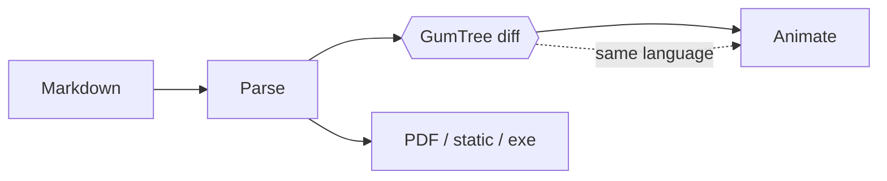

## Diagrams

A `mermaid` fence draws a diagram with the slide's colors; press **t** to see it follow the theme.

<!-- Mermaid is loaded when a slide first needs it and left out of builds whose decks never use it. -->
